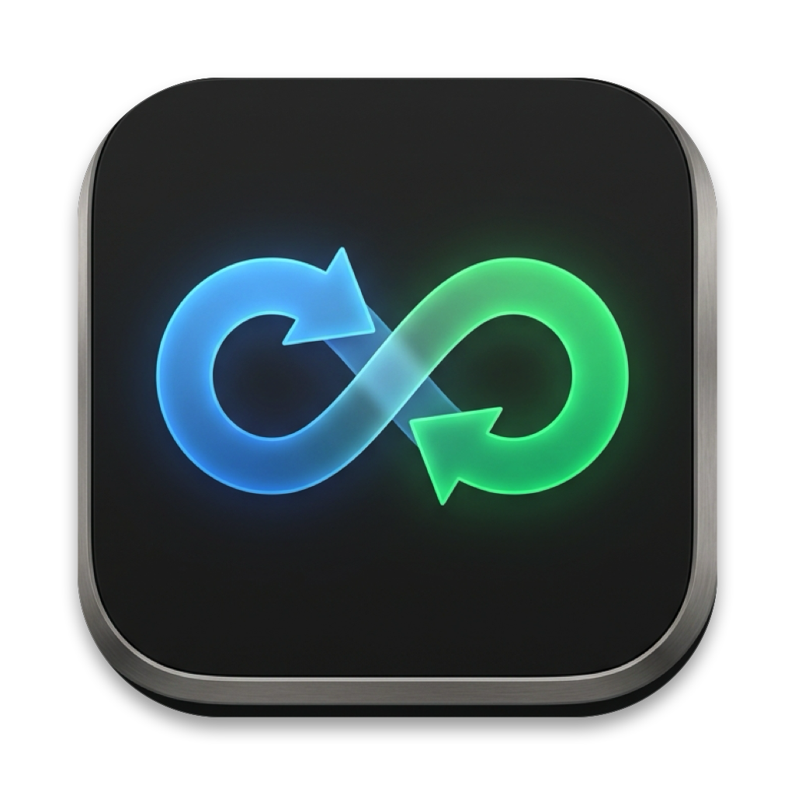
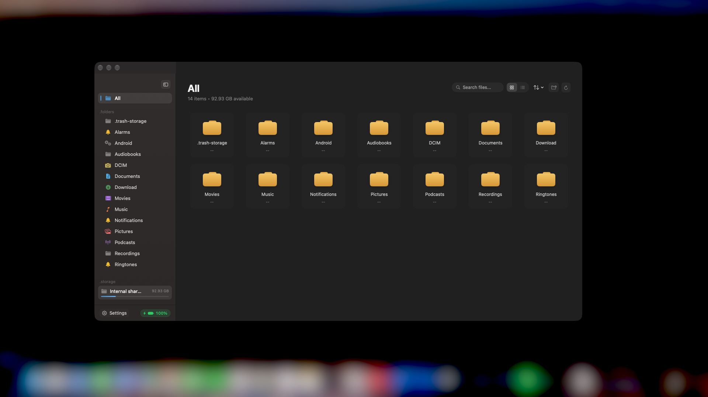

# MacSync

<div align="center">



# MacSync

**A modern, blazing-fast native macOS Android file transfer app.**  
Direct USB connection via `libmtp` without ADB, Android File Transfer bugs, or background daemons.

<br />



</div>

---

## ✨ Features

- **Direct MTP Engine**: High-throughput C-bridging to `libmtp` without requiring Android Debug Bridge (ADB) or developer mode.
- **Liquid macOS UI**: Built natively in SwiftUI for macOS 14+ with dark matte charcoal aesthetics, frosted vibrancy, and fluid spring animations.
- **Dynamic Floating Island**: Non-intrusive progress HUD with live throughput, completion status, and zero-latency cancellation.
- **Conflict Resolution**: Interactive conflict sheet for existing files (Replace, Keep Both with auto-indexing, Skip, or Apply to All).
- **macOS Native Selection**: Full keyboard & gesture support including `Cmd+Click` (toggle), `Shift+Click` (range selection), and instant double-click navigation.
- **In-App QuickLook & Thumbnails**: Spacebar preview for remote and local files, and asynchronous on-demand thumbnail generation for Android media.
- **Drag & Drop**: Native drag-in and drag-out directly between Android folders and macOS Finder.
- **Standalone Distribution**: Fully self-contained app bundle embedding `@rpath` patched `libmtp` and `libusb` libraries with codesign entitlements—no Homebrew required on target machines.

---

## 🛠 Prerequisites

To build and develop from source:

- macOS 14.0 (Sonoma) or later
- Swift 5.9+ / Xcode 15+
- [Homebrew](https://brew.sh) (for build-time `libmtp` and `libusb` headers)
- `xcodegen` (optional, for regenerating `.xcodeproj`)

```bash
brew install libmtp libusb xcodegen
```

---

## 🚀 Building & Running

### Fast Build & Bundle
Run the turnkey build script to compile, assemble the `.app` bundle, inject rpaths, and sign entitlements:

```bash
chmod +x build.sh
./build.sh
open MacSync.app
```

### Xcode Project
Generate or update the Xcode project via XcodeGen:

```bash
xcodegen generate
open MacSync.xcodeproj
```

---

## 🏗 Architecture

```
MacSync/
├── App.swift                     # NSApplication entry point & window styling
├── Bridging-Header.h             # C-bridging for libmtp
├── Controllers/
│   └── QuickLookController.swift # Native QLPreviewPanel integration
├── Models/
│   └── MTPModels.swift           # MTPItem, TransferProgress, ConflictAction
├── Services/
│   ├── LocalFileService.swift    # macOS filesystem operations
│   └── MTPService.swift          # Actor-based libmtp wrapper with non-isolated cancellation
├── ViewModels/
│   └── AppViewModel.swift        # MainActor state coordinator
└── Views/
    ├── ContentView.swift         # Unified dual-pane navigation & floating island
    └── FilePaneViews.swift       # Reusable grid and list layouts
```

---

## 📄 License

GPL-3.0 License. See [LICENSE](LICENSE) for details.
